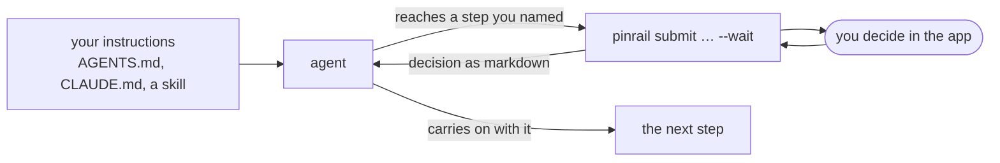

Pinrail never interrupts an agent on its own. The agent decides when to ask, because its instructions tell it to: "before posting review comments, submit them to Pinrail and wait." This page shows where those instructions go, what makes them work, and a template to start from. It also covers the two ways you direct an agent from the app: starting it on a work item, and sending it messages while it works.



## Start with the Pinrail skill

In *Settings › Agents*, choose *Connect* next to your agent. Pinrail installs a global skill named `pinrail` that teaches the agent how to use Pinrail: how to ask you questions with `pinrail ask` instead of in the chat, how to report its progress with `pinrail status`, how to submit a review and wait for it, how to read your decision, how to send a new round when you ask for changes, and what to do when you discard a review. It also teaches the agent to work with [work items](/docs/concepts/work-items/): to read an item before it works on it, to search before it adds one, to comment on its progress, and to mark the item done. See [Settings](/docs/using/settings/#agents), and [Supported agents](/docs/agents/supported/) for the agents that take the skill.


The skill is generic. It does not tell the agent when to ask or which plugin to use, because that depends on your work and usually differs from one project to another. You add those instructions yourself.

The best place for them is a skill in the project. The agent reads a skill when the task matches the skill's description, and a skill in the repository applies to everyone who works there. Your skill only needs to name the moment to ask, the plugin to use, and what to do with your answer. The `pinrail` skill covers everything else.

```md title=".claude/skills/review-comments/SKILL.md"
---
name: review-comments
description: Use before posting review comments on a pull request in this repository.
---

Before you post review comments, ask me through Pinrail with the
`code-review` plugin and wait for my decision. Don't ask in chat.

- Send one proposal per comment, anchored on its file and line.
- Post only the comments I accept, and apply my notes to them first.
  Never post undecided comments.
```

This example is for Claude Code. Other agents that support skills keep a project's skills in a folder of their own, which their documentation names. For an agent without skills, or one where you have not connected the `pinrail` skill, write the full instructions described below in its instructions file.

## Start an agent on a work item

You start an agent on a work item in two places:

- **From the item's panel**, with the **Start** button beside the item's status. See [An item's panel](/docs/using/work-items/#an-items-panel).
- **From the quick add**, which adds the item and starts an agent on it at once. Click **Add and start**, or press <kbd>⌥Enter</kbd> in the title. See [Add an item from any page](/docs/using/work-items/#add-an-item-from-any-page).


Both start the agent that you used most in the last 30 days, in the folder of the item's repository that you used last. The arrow beside the button changes the agent and the folder, and Pinrail asks for a folder when it knows none for the repository.

Either way, the item is the agent's first prompt, and the new session claims the item. The prompt holds:

- the item's key and title, as its heading;
- the item's description;
- every comment on the item, with who wrote it and when;
- the names of the files attached to the description and the comments, with the command that saves them, `pinrail items show <key>`.

So write an item's description as the task you would give the agent:

- **Say what to do and what done means.** The agent has nothing but the item to start from. *Exports have no limit* describes a problem. *Limit exports to 100 a minute for each API key, and answer 429 with Retry-After* is a task.
- **Put what you know in the item.** A decision you already took, a file to start from or a screenshot of the bug saves the agent a question. Comments reach the agent too, so add what you learn later as a comment.
- **Leave the standing rules where they are.** When to ask and which plugin to use belong in the agent's instructions, as this page describes, and apply to every item.

An agent with the `pinrail` skill reads the item again with `pinrail items show` before it continues it, keeps the description current as the work becomes clearer, and marks the item done with a comment that says what changed and where.

## Send the agent a message

You write to an agent from its [session's thread](/docs/concepts/sessions/#messages-to-the-agent) in the app. How the message arrives depends on where the agent runs:

- **An agent that Pinrail runs** gets the message as its next prompt. Pinrail types it into the agent's terminal once the agent is idle.
- **An agent in your own terminal** gets the message the next time it runs `pinrail status`, which prints every waiting message.

A comment that you add to a work item the session holds, and putting such an item on hold, reach the agent in the same way as a message to an agent in your own terminal: with its next `pinrail status`.

The `pinrail` skill tells the agent to report its progress with `pinrail status`, so an agent that follows it sees your messages as it works. An agent that reports rarely sees them late. If you want an agent in your own terminal to act on a message at once, tell it so in its instructions:

```md title="AGENTS.md"
Run `pinrail status` at the start of each step. If it prints a message
from me, act on the message before you go on, and say what you did in
your next status.
```

## Work items the agent adds

An agent with the `pinrail` skill searches before it adds a work item, with `pinrail items search`, and before it works on a bug. When an item already covers the work, it comments on that item and does not add another. `pinrail items add` also lists the three items most like the new one, for the agent to check. You do not need to instruct the agent to do this. Add a rule only for what is particular to your project, such as which work becomes an item at all. See [Work items](/docs/agents/cli/#work-items) in the CLI guide.

## Where instructions go

Put them wherever your agent already reads its standing instructions. The words are the same for every agent; only the file changes.

| Agent | Where |
|---|---|
| Claude Code | A skill in `.claude/skills/` in the repository, or `CLAUDE.md` |
| Codex, Cursor, OpenCode, and others | `AGENTS.md` in the repository |
| Gemini CLI | `GEMINI.md` |
| A CI job or script | The prompt or the script itself. See [Scripts and CI](/docs/agents/workflows/). |

Instructions in the repository apply to everyone who runs an agent there. Instructions in your personal settings apply to you, everywhere.

:::tip[Let the agent read up]
`pinrail docs` tells an agent how to use Pinrail in a screen, and leads it to short pages on asking, plugins and writing its own rules. Point your agent at it and describe the moment you want it to ask: it can write the rule itself. See [Built-in guidance for agents](/docs/agents/cli/#built-in-guidance-for-agents).
:::

## What good instructions say

An agent follows instructions literally. Say four things, plainly:

1. **When to ask.** Name the moment: *before posting review comments*, *before sending email*, *before deleting anything in production*. A vague rule ("ask when unsure") gets you asked about everything or nothing.
2. **What to send.** Name the plugin and describe the payload in a sentence, so the agent knows what to put in it. The agent can read the exact shape, with an example, from `pinrail plugins describe <plugin>`; each [plugin page](/docs/plugins/) has it too.
3. **The command.** Give it exactly, with `--wait` so the agent blocks until you decide. The answer comes back as markdown, which the agent reads as prose.
4. **What to do with the answer.** Which verdicts to act on, what notes mean, what to do with anything undecided, and what to do if you say stop.

:::tip[Markdown for agents, JSON for scripts]
The decision comes back as a short document the agent reads like any other text: the title, who decided, and each verdict with its note. A step that processes it instead, looping over items or handing it to a script, adds `--json`.
:::

## A template

Start from this and fill in the parts in angle brackets. The [plugin pages](/docs/plugins/) each have a version tailored to that plugin. The template spells out every step for an agent that does not have the `pinrail` skill. With the skill connected, you can leave out the last line and steps 4 and 5, because the skill already covers them.

```md title="AGENTS.md"
## Ask before <the step>

Before you <the step>, ask me through Pinrail and wait for my decision.
Don't ask in chat and don't go ahead without an answer.

1. Write <what you're proposing> to a JSON file for the `<plugin>` plugin:
   <one sentence on the payload's shape>. Run
   `pinrail plugins describe <plugin>` for the schema and an example.
2. Run:
   pinrail submit <plugin> --title "<a title I'll recognise>" \
     --data <file>.json --wait
3. Act on the decision: <which verdicts to act on, and how to use notes>.
   Treat anything undecided as not approved.
4. If I ask for changes, make them and submit again with
   `--revises <the review's id>`, so I see the new round beside the old one.
5. If the command exits 5, I discarded the review: stop the work it was
   about, tell me my reason, and don't ask again.

`pinrail docs` explains Pinrail itself, if you need more.
```

The agent does not need to say where the review comes from. Inside a git checkout, `pinrail submit` fills in the repository and the branch itself, and the app groups the review under that project.

## Handle every outcome

`pinrail submit --wait` blocks until the review ends, then exits with a code that says how. Tell your agent what each one means for it:

| Exit | The review | The agent should |
|---|---|---|
| `0` | Was decided. | Act on the decision it printed. |
| `3` | Was withdrawn, or expired before anyone decided. | Stop, and say nobody decided. |
| `4` | Is still waiting: `--timeout` ran out. | Carry on with other work and check later. See below. |
| `5` | Was discarded: you said no, and stop. | Stop the work, report your reason, and not ask again. |
| `1`, `2` | Could not be submitted. | Report the error. A `2` means the payload failed the plugin's schema. |

:::caution[Exit 5 means stop]
Discarding is your "no, and stop". An agent that gets exit 5 should drop the work the review was gating, not retry it and not submit a new round. Say so in your instructions.
:::

## When you're away

An agent does not have to block forever. With `--timeout`, it stops waiting after that many seconds and exits 4, and the review stays in your inbox:

```sh
pinrail submit list --title "Nightly cleanup" --data items.json --wait --timeout 600
```

Decide whenever you are back. The agent picks up your decision the next time it looks:

```sh
pinrail wait <id>    # returns at once with the decision, now that there is one
pinrail show <id>    # where the review stands, and its decision
```

## Rounds

When you ask for changes, the agent makes them and submits a new round that names the one it answers:

```sh
pinrail submit code-review --title "Dedup tickets on save — round 2" --revises <id> --data review.json --wait
```

The app shows the new round with your previous verdicts beside each item, so you only review what changed. Every round is kept. `pinrail rounds <id>` prints them all, oldest first.

## Several questions at once

Short, independent questions go in one `pinrail ask`, up to 10 of them, which you answer in the session's thread in the app. Questions that depend on each other, or need a long explanation each, go in one review with the `feedback` plugin, which takes several groups of questions answered in one pass; `list` groups items under headings. See [Asking questions](/docs/agents/cli/#asking-questions).

When the reviews are independent, or need different plugins, the agent submits each one without `--wait`, then waits on them:

```sh
a=$(pinrail submit code-review --title "Dedup tickets on save" --data review.json --json | jq -r .id)
b=$(pinrail submit email --title "Renewal emails" --data drafts.json --json | jq -r .id)

pinrail wait "$a"   # returns when this one is decided
pinrail wait "$b"   # at once, if you decided it meanwhile
```

The reviews are all pending together, so you can decide them in any order. Waiting on each in turn ends when the last one is decided, and each `wait` exits with its own [exit code](/docs/agents/cli/#exit-codes), so the agent knows how each one ended.

:::tip[Act on each answer as it comes]
An agent that can run commands in the background, such as Claude Code, can start one `pinrail wait` per review and act on each decision as soon as it arrives, without waiting for the rest.
:::

## Files

Some plugins take files beside the payload, such as the [Image review](/docs/plugins/image/) plugin. Where a file goes, and which kinds and sizes are accepted, is the plugin's to say: its payload schema marks the places a file belongs, and `pinrail plugins describe <name>` shows that schema with the plugin's limits. There is nothing to add to your instructions beyond pointing the agent at the plugin's description, as the [template](#a-template) already does; when the payload asks for a file, the agent sends it with `--attach <path>`.

The review shows every file it carries by name and size, and you can save any of them.

## Check that it works

Ask your agent to do the step, and watch for the review in your inbox, under **Waiting on you**. If it doesn't arrive:

- **The agent went ahead without asking.** Make the "when" more specific, and move it higher in the file.
- **The command failed.** Run `pinrail list` yourself. If it cannot reach the app, see [Finding the app](/docs/agents/cli/#finding-the-app).
- **Exit 2.** The payload did not match the plugin's schema. The error names the field, so the agent can fix the payload and submit it again. Tell the agent to read the schema from `pinrail plugins describe <plugin>` before it writes the payload.
