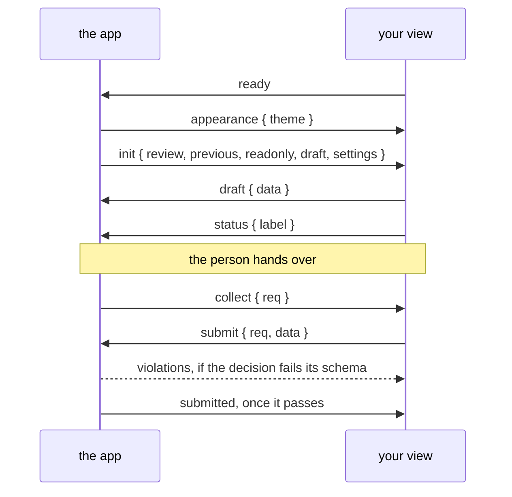

A view and the app talk over `postMessage`. The SDK, `/sdk/v1/pinrail-plugin.js`, speaks this protocol for you, and most plugins never see a raw message. Read this page when you want to know exactly what happens, or to write a view without the SDK.

## Messages

Every message is a JSON object with the protocol version and a type:

```json
{
  "pinrail": 1,
  "type": "draft",
  "data": { "decisions": [] }
}
```

The view announces itself with `ready`, and the app answers with `init`. With the SDK, `Pinrail.connect` sends `ready`, and a document calls it once. From then on, either side can send. A view sends `ready` once: a second `ready` from the frame means another page has taken the view's place, and the app sends nothing more to that frame. The app accepts messages only from the view's own frame. The view should accept messages only from the app: it checks that `event.source` is `window.parent`, and after `init`, that `event.origin` equals the `app_origin` that `init` gives.



## From the app to your view

| Type | Fields | When |
|---|---|---|
| `init` | `review`, `previous`, `readonly`, `draft`, `settings`, `app_origin`, `capabilities` | In answer to `ready`. It comes again, with `readonly: true`, when the review stops being pending while the view is open, for example when the agent withdraws it. After the view's own hand-over, `submitted` comes instead. |
| `attachment` | `req`, `ok`, and `name`, `media_type`, `size`, `bytes`; or `error` | The answer to the view's `attachment`, with the same `req`. `bytes` is an `ArrayBuffer`, transferred. |
| `collect` | `req` | The person pressed the hand-over button, or <kbd>⌘↵</kbd>. The view answers with `submit` or `defer` and the same `req`. |
| `violations` | `errors: [{ path, message }]` | A submitted decision failed the decision schema. |
| `submitted` | `decision` | The decision was accepted. The app then returns to the inbox and closes the view, so there is no need to show the decision. When the person opens the review again, `init` comes with `readonly: true` and the decision. |
| `appearance` | `theme: "dark" \| "light"`; `tokens`, a map of `--pinrail-*` colours | Before `init`, and whenever the app's theme changes. `tokens` is empty for a built-in theme. |
| `settings` | `settings`; or `req`, `ok`, and `errors` when not `ok` | The plugin's own settings changed, in the app or from a view. With `req`, the answer to the view's `settings_set`: `ok: true` when the app kept the change, or `ok: false` and the errors when the settings schema refused it. |
| `key` | `key`, `code`, `metaKey`, `ctrlKey`, `altKey`, `shiftKey` | A shortcut the manifest declares, pressed while the app, not the frame, had focus. |
| `find` | `req`, `query`, `backwards` | The person searched the view from the app's find bar. The view answers with `found` and the same `req`. |
| `dictation` | `req`, and `text`; or `done: true` and `error` when it failed | For the view's `dictation_start` with the same `req`: the text heard so far, sent again each time it grows, then once that the dictation is over. |
| `clipboard` | `req`, `ok`, and `error` when not `ok` | The answer to the view's `clipboard_write` with the same `req`: `ok: true` once the app has copied, or `ok: false` and why it did not. |

### `init`

`init` carries everything the view needs to render.

| Field | Type | Meaning |
|---|---|---|
| `review` | object | The review, with the fields below. |
| `previous` | object or `null` | The round this review revises, with the same fields and its decision, so you can show earlier verdicts beside the new ones. |
| `readonly` | boolean | `true` whenever the review is not pending. |
| `draft` | any or `null` | What the view last posted as a draft for this review. |
| `settings` | object | The plugin's own settings: every key the manifest declares, with its current value. |
| `app_origin` | string | The app's origin. Accept messages from it alone. |
| `capabilities` | string array | What the app can do beyond the messages that every app answers. `"dictation"` means it can turn speech into text for the view, with `dictation_start`. `"clipboard"` means it copies for the view, with `clipboard_write`; the app offers it only to a plugin whose manifest declares the `clipboard` capability. A later addition is named here too, so a view can tell whether the app it runs in has it. |

`review` and `previous` have these fields, and no others:

| Field | Type | Meaning |
|---|---|---|
| `id` | string | The review's id. |
| `title` | string | The title the agent gave it. |
| `status` | string | `pending`, `decided`, `withdrawn`, `discarded` or `expired`. |
| `created_at` | string | When the agent sent it, as an RFC 3339 timestamp. |
| `payload` | any | The payload, as the payload schema describes it. |
| `attachments` | array | The files it carries, each with its `name`, `size`, `media_type` and `sha256`. |
| `decision` | object or `null` | Once the review is decided: `data`, the decision itself, and `decided_by` and `decided_at`. |

`previous` and `draft` can come from an earlier release of the plugin, because a pending review moves to a newer release when it is opened. Check their shape before you use them, and fall back to an empty view when they do not match.

A review is read-only for one of four reasons, and `review.status` says which:

| `review.status` | Meaning |
|---|---|
| `decided` | A decision was handed over. It is in `review.decision`. |
| `withdrawn` | The agent took the review back before anyone decided. |
| `discarded` | The person said no and told the agent to stop. |
| `expired` | The review passed its expiry without a decision. |

Render all four the same way: what was there, and nothing to submit.

### `collect`

`collect` asks for the decision. Answer it once, with `submit` and the same `req`, or with `defer` when there is nothing to hand over yet: an answer is missing, or the view shows what would be sent and waits for the person to confirm. The next press of the button is a new request, with a new `req`.

The app accepts one answer per request, and only for the request that is open. A `submit` the app did not ask for, a second answer to one request, and an answer that comes after the app stopped waiting all decide nothing. The app stops waiting after a minute, when the frame reloads, and when the review ends.

With the SDK, `onCollect` returns the decision, and the SDK sends the answer.

:::note
A view never draws its own submit button. The app puts one below every review, in the same place for every plugin, so nothing leaves on a single click and the person always knows where to look.
:::

### `violations`

The app validates every decision against the plugin's decision schema before the agent sees it. When one fails, the errors come back with a [JSON Pointer](https://datatracker.ietf.org/doc/html/rfc6901) into the rejected decision:

```json
{
  "pinrail": 1,
  "type": "violations",
  "errors": [
    {
      "path": "/decisions/0/action",
      "message": "\"later\" is not one of [\"close\",\"keep\"]"
    }
  ]
}
```

Show them next to the fields they name, and let the person hand over again.

### `dictation`

The view's frame cannot use the microphone. The app listens instead, and shows the person that it is listening. It stops the dictation when the person stops it in the app, when the review becomes read-only, and when the view goes. With the SDK, `plugin.dictate(field)` writes the text into a field at its cursor, and a field marked `data-pinrail-dictate` gets a microphone button.

### `clipboard`

The view's frame cannot write to the clipboard, so the app copies for it. Only a plugin whose manifest declares the capability is offered this:

```json title="manifest.json"
{ "capabilities": ["clipboard"] }
```

`clipboard_write` carries either `text` or `attachment`, the name of an image the review carries. The app copies an image as PNG, and shows the person a notice for every copy, since a request from the view cannot prove that the person clicked something. It refuses a request that has neither field or both, an attachment that the review does not carry or that is not an image, and text longer than 1,000,000 characters. A read-only review can copy too, so a person can copy the text of a decided review to publish it. With the SDK, `plugin.canCopy` says whether the app offers the clipboard, and `plugin.copy({ text })` or `plugin.copy({ attachment })` returns a promise that resolves once the app has copied.

### `key`

A shortcut you declare in the manifest reaches your view even when the person pressed it with the app in focus. The SDK dispatches it as a `keydown` on your document, marked `pinrailForwarded: true`, so the listener you already have handles both. See [Settings and keys](/docs/building/settings-and-keys/#keyboard-shortcuts).

### `find`

The app's find bar searches the view's text, which only the view can reach. Each `find` carries a new `req`. When `query` is the same as in the previous `find`, the view moves to the next match, or to the previous one when `backwards` is `true`; otherwise it starts over from the first match in sight. An empty `query` closes the search and removes the highlights.

The SDK answers `find` for you. It searches the text the view shows, ignoring case, highlights every match with the CSS Custom Highlight API, and scrolls the current match into view. It answers again whenever the view's content changes while the search is open. It does not search text in form fields, in images or on a canvas, or in parts of the view that take up no space, such as a collapsed section.

## From your view to the app

| Type | Fields | Effect |
|---|---|---|
| `ready` | | The view is listening. The app answers with `init`. |
| `draft` | `data` | Keeps work in progress. It comes back in `init` as `draft`, for as long as the app keeps running. |
| `status` | `label` | What the app's hand-over button should read, such as `Hand over 3 of 5`. With the SDK, `plugin.handOverLabel` sends it. |
| `submit` | `req`, `data` | The decision, in answer to the `collect` with the same `req`. Validated against the decision schema. |
| `defer` | `req` | Nothing to hand over for the `collect` with the same `req` yet. |
| `settings_set` | `req`, `patch` | Writes the plugin's own settings. The app answers with `settings` and the same `req`, and everyone hears the values as they now stand as `settings`. With the SDK, `plugin.setSetting` returns a promise of the settings. |
| `key` | `key`, `code`, `metaKey`, `ctrlKey`, `altKey`, `shiftKey` | One of the app's own keys on the review screen, <kbd>?</kbd>, <kbd>[</kbd>, <kbd>]</kbd>, <kbd>J</kbd>, <kbd>K</kbd> or <kbd>Esc</kbd>, pressed in the view outside a text field and left alone by it, or <kbd>⌘↵</kbd>, <kbd>⌘D</kbd> or <kbd>⌘F</kbd> pressed anywhere in the view and left alone by it. The SDK sends it; the app acts on it as if pressed in its window: <kbd>⌘↵</kbd> starts the hand-over, <kbd>⌘D</kbd> asks to discard the review, and <kbd>⌘F</kbd> opens the find bar. |
| `found` | `req`, `count`, `current` | The answer to the `find` with the same `req`: how many matches there are, at most 1,000, and which one is current, counted from 1, or 0 when there are none. The view sends it again when its content changes. |
| `open` | `url` | Asks the app to open a link in the person's browser. Only `http`, `https` and `mailto` addresses are considered. The app asks the person first, unless they allowed the address's origin for this plugin. It always asks about a `mailto` address and an address longer than 2,000 characters, and it ignores `open` messages that arrive while it is asking. |
| `attachment` | `req`, `name`, and `round: "previous"` for a file of the round this one revises | Asks for the bytes of a file the review carries. The app answers with `attachment` and the same `req`. |
| `dictation_start` | `req` | Asks the app to listen and turn speech into text, when `init.capabilities` has `"dictation"`. The app answers with `dictation` messages and the same `req`. One dictation is on at a time: a new request ends the one before. An app that cannot dictate, or a read-only review, answers at once with `done: true` and an `error`. |
| `dictation_stop` | `req` | Asks the app to stop the dictation with the same `req`. The last words, and the message that it is done, still come. |
| `clipboard_write` | `req`, and `text` or `attachment` | Asks the app to copy text, or an image the review carries, by its name, when `init.capabilities` has `"clipboard"`. The app answers with `clipboard` and the same `req`. |

### `attachment`

A view's frame can fetch nothing, so a file the review carries arrives this way. Number each request:

```json title="the view asks"
{
  "pinrail": 1,
  "type": "attachment",
  "req": 7,
  "name": "pivot.glb"
}
```

The answer carries the same number, and the bytes as an `ArrayBuffer`:

```json title="the app answers"
{
  "pinrail": 1,
  "type": "attachment",
  "req": 7,
  "ok": true,
  "name": "pivot.glb",
  "media_type": "model/gltf-binary",
  "size": 1843302,
  "bytes": "<ArrayBuffer>"
}
```

The app answers only for names in `review.attachments` (or in `previous.attachments`, with `round: "previous"`), and says why otherwise, with `ok: false` and `error`. Ask again for another copy: each answer transfers its buffer.

## The first frame

A message cannot reach your view before it paints, so the theme travels on the frame's URL too: it ends in `#pinrail-theme=dark` or `#pinrail-theme=light`. The SDK reads it as it loads and sets `data-theme` on your root element, so the first frame is already in the app's theme. A custom theme's colours follow as `&pinrail-tokens=`, base64url-encoded JSON of the same map as `tokens`, and the SDK sets them on your root element's style.

```css
:root { --bg: #18191b; --text: #ededef; color-scheme: dark; }
[data-theme="light"] { --bg: #ffffff; --text: #24262c; color-scheme: light; }
```

:::caution[Load the SDK with a plain script tag]
`<script src="/sdk/v1/pinrail-plugin.js">` runs before the first paint. A `defer` or `type="module"` script runs after it, which is too late to choose a colour.
:::

## Without the SDK

The SDK is a convenience, not a requirement. A view that speaks the protocol itself needs about this much:

```js title="view/index.html (script)"
let shell = null;

addEventListener("message", (event) => {
  const msg = event.data;
  if (event.source !== parent) return;              // only the app's window
  if (!msg || msg.pinrail !== 1) return;
  if (msg.type === "init") shell = msg.app_origin;
  if (event.origin !== shell) return;              // and only the app's origin

  switch (msg.type) {
    case "init": render(msg.review, msg.readonly, msg.draft); break;
    case "collect": {
      const data = decision();                       // undefined: nothing yet
      post(data === undefined ? { type: "defer", req: msg.req } : { type: "submit", req: msg.req, data });
      break;
    }
    case "violations": showErrors(msg.errors); break;
    case "submitted": showDecided(msg.decision); break;
  }
});

const post = (msg) => parent.postMessage({ pinrail: 1, ...msg }, shell ?? "*");
post({ type: "ready" });
```

Without the SDK, your view must also do the following: apply the theme before the first paint, forward links with `open`, forward <kbd>⌘↵</kbd>, <kbd>⌘D</kbd> and <kbd>⌘F</kbd> to the app as `key`, and answer `find` with `found`, or the find bar finds nothing in it.

## Versions

`v1` in `/sdk/v1/` is the protocol's major version. The app serves the SDK itself, so every review, including one decided months ago, loads the SDK of the installed app. Within `v1`, the SDK changes only in ways that keep existing views working.
