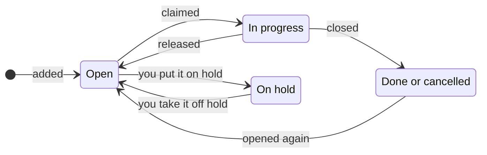

A work item is a task recorded in Pinrail, such as a feature, a bug or a step of a plan. You and your agents share the same items: you add and arrange them in the app, and agents add, take and close them with `pinrail items`. Pinrail works out which items are ready, so that an agent can take the next one without asking you.

:::tip[Built for agents]
Work items are not a general task manager. They have no tags, no boards, no deadlines and no priority field. They are task tracking built for agents first: each item has dependencies and sub-items that decide when it can start, and its state changes follow strict rules that Pinrail enforces for agents and people alike. An item cannot be done while a sub-item is open, an agent cannot close an item while a review of it waits for you, and no dependency may close a circle. An agent can therefore work through the items on its own and leave a record you can trust.
:::

## What a work item holds

| Part | What it is |
|---|---|
| **Key** | The repository's prefix and a number, such as `PIN-42`. It names the item everywhere: in the CLI, in commit messages and in any text Pinrail shows. |
| **Title and description** | What the work is, in Markdown, with any files attached to it, such as screenshots or logs. |
| **Repository** | The repository the item belongs to, which numbers it. Through the repository, the item belongs to its [project](/docs/using/projects/). |
| **Parent and sub-items** | An item can be part of a larger one. A parent waits for its sub-items. |
| **Dependencies** | The items that must be done before this one can start. |
| **Holder** | The agent session, or you, working on the item now. |
| **Reviews and questions** | What was sent to you about the item, in the inbox and in the item's panel. |
| **Comments and activity** | Notes from you and from agents, and every change, with who made it and when. |

## How a work item moves

An item is open until someone claims it, and ends done or cancelled. Either can be opened again. You can also close an open item without claiming it, and putting an item on hold releases it if it was in progress.

| State | What it means |
|---|---|
| **Open** | Nobody is working on it. |
| **In progress** | A session, or you, has claimed it. |
| **On hold** | Kept for later. No agent takes it or any of its sub-items, and only you put it on hold or take it off. |
| **Done** | The work is finished. |
| **Cancelled** | It will not be done. Its open sub-items are cancelled with it. |

An item can be marked done only when each of its sub-items is done or cancelled. An agent must also wait until no review or question of the item waits for you. When the last open sub-item of a parent closes, and at least one of them is done, the parent is done too, unless someone works on it or something of it waits for you. You can turn this off in *Settings › Work items*.

## Ready and blocked

Pinrail derives two more conditions from the items' dependencies and sub-items:

- An open item is **ready** when every item it depends on is done and it has no open sub-item.
- An item that waits for another is **blocked**. A parent is blocked by its open sub-items in the same way.

An item on hold still blocks the items that depend on it. Pinrail refuses a dependency or a parent that would make items wait for each other in a circle.

## Who holds an item

An agent claims an item with `pinrail items next --claim` or `pinrail items edit <key> --claim`, and you claim one in the app.

:::tip[One holder at a time]
An item has a single holder: one agent session, or you. Nobody can claim an item that someone else is working on. Pinrail refuses the claim and names who holds it, such as *PIN-42 is claimed by claude-code (session 7f3a…)*, and `pinrail items next` offers only items nobody holds. Two agents therefore never work on the same item by accident. Taking an item over is a deliberate step: an agent must ask for it with `pinrail items edit <key> --claim --take`, and you take one over from the app. An agent also cannot close an item that another session holds.
:::

While a session holds an item:

- the reviews and questions the session sends belong to the item, and a session that holds several names the ones each is for with `--item`;
- the item's panel lists the session, and the session's thread shows the agent's changes to the item and its comments on it;
- a comment you add to the item reaches the agent the next time it runs `pinrail status`.

Putting an item on hold releases it and its sub-items, and each agent working on one is told to stop. A session that Pinrail deletes with the history, as *Keep reviews for* in *Settings › Data* says, releases what it held.

## Which item comes next

`pinrail items next` offers the next ready item of the agent's repository, in this order:

1. a ready sub-item of an item the session already holds;
2. the first ready item of your queue;
3. the item that unblocks the most other items;
4. the oldest item.

There is no priority field. To choose what an agent takes next, queue the item: the queue is one list across all your repositories, and only you change it.

## Where to go next

- [Work items](/docs/using/work-items/): the Work items page, an item's panel, and the keys to use.
- [Agents › CLI](/docs/agents/cli/): the `pinrail items` commands an agent uses.
- [Reviews](/docs/concepts/reviews/): what a review is, and how it ends.
